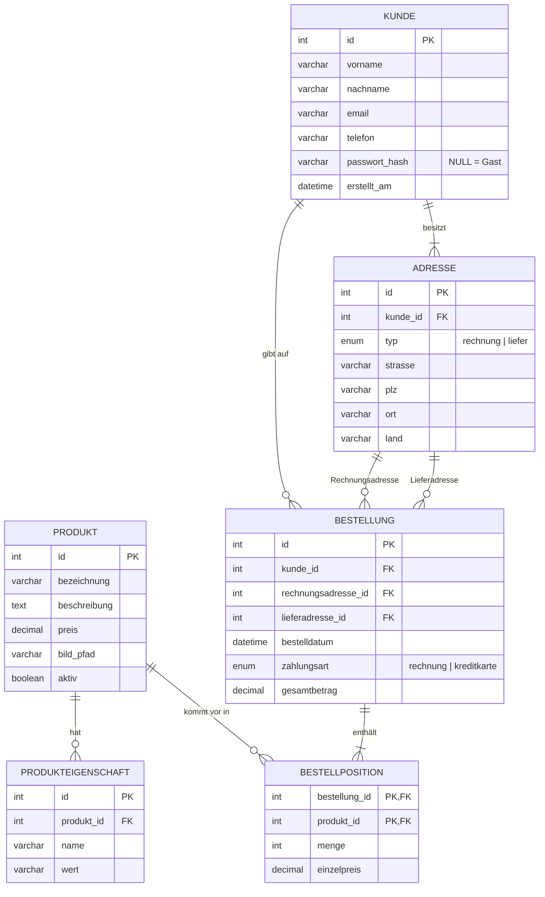

# Webshop „Röstwerk“ – LAP-Praxisbeispiel

Vollständige Ausarbeitung der Aufgabe „Webshop“ mit
**Angular 22 + Angular Material (SCSS)**, **Node.js/Express 5 (ESM, reines JavaScript)** und **MariaDB**.

| Aufgabe | Umsetzung |
|---|---|
| 1 ER-Diagramm + Zeitschätzung | Abschnitt [1](#1-datenbank-design-er-diagramm) und [Zeitschätzung](#2-zeitschätzung) unten, SQL in `datenbank/webshop.sql` |
| 2a Produktliste mit Bild | `frontend/src/app/pages/produktliste` · `GET /api/produkte` |
| 2b Produktdetails mit allen Eigenschaften | `pages/produkt-detail` · `GET /api/produkte/:id` |
| 2c Produkte/Eigenschaften in DB, Bilder im Dateisystem | Tabellen `produkt`, `produkteigenschaft`, Spalte `bild_pfad`, Ordner `backend/bilder` |
| 3a Warenkorb | `services/warenkorb.service.ts` (Signals + localStorage), `pages/warenkorb` |
| 3b Kundendaten (Adressen, E-Mail, Telefon) | `pages/kasse` (Reactive Forms) · Tabellen `kunde`, `adresse` |
| 3c Zahlungsart (nur Auswahl) | Radio-Buttons in der Kasse, Spalte `bestellung.zahlungsart` |
| 4 Rechnung anzeigen + per Mail | `pages/rechnung` · `backend/src/services/rechnung.js`, `mail.js` (nodemailer) |
| 5 Auf allen Geräten nutzbar | Responsive Layout mit CSS Grid + Media Queries |
| 6 Logische, ansprechende Oberfläche | Angular Material, klare Navigation, Feedback (Snackbar, Fehlermeldungen) |
| 7 Statistik | `pages/statistik` · `GET /api/statistik` |
| 8 Hosting-Anforderungen | Abschnitt [3](#3-anforderungsliste-hostingumgebung) unten |
| 9 Kundenkonto | Konto beim Bestellen oder über „Registrieren“, Login mit JWT, Daten werden vorausgefüllt |

---

## Projekt starten

**Voraussetzungen:** Node.js ≥ 20, MariaDB ≥ 10.6, Angular CLI (`npm i -g @angular/cli`)

```bash
# 1. Datenbank anlegen (inkl. Testdaten und DB-Benutzer "webshop")
mariadb -u root -p < datenbank/webshop.sql

# 2. Backend
cd backend
cp .env.example .env      # Werte bei Bedarf anpassen
npm install
npm run dev               # http://localhost:3000

# 3. Frontend (zweites Terminal)
cd frontend
npm install
ng serve                  # http://localhost:4200
```

Ohne SMTP-Daten in `.env` wird die Rechnungs-Mail nicht verschickt, sondern nur in der Backend-Konsole protokolliert.
Zum echten Testen z. B. einen Gmail-App-Passwort-Zugang oder Mailtrap eintragen.

## Projektstruktur

```
webshop/
├── datenbank/webshop.sql          Tabellen, Testdaten, DB-Benutzer
├── backend/
│   ├── bilder/                    Produktbilder (Dateisystem)
│   ├── .env.example               Konfiguration (Kopie als .env)
│   └── src/
│       ├── server.js              Express-App, Middleware, Routen, Fehlerbehandlung
│       ├── db.js                  MariaDB-Connection-Pool
│       ├── validierung.js         Eingabeprüfung
│       ├── middleware/auth.js     JWT prüfen / erstellen
│       ├── routes/                produkte, bestellungen, statistik, auth
│       └── services/              rechnung (Daten + HTML), mail (nodemailer)
└── frontend/src/app/
    ├── app.*                      Grundgerüst mit Navigation
    ├── app.routes.ts              Routen (Lazy Loading)
    ├── app.config.ts              HttpClient, Interceptor, Locale de-AT
    ├── auth.interceptor.ts        hängt das Token an jeden Request
    ├── models.ts                  TypeScript-Interfaces
    ├── services/                  produkt, warenkorb, bestellung, auth
    └── pages/                     produktliste, produkt-detail, warenkorb, kasse,
                                   rechnung, statistik, login, registrieren
```

## REST-API

| Methode | Route | Beschreibung | Auth |
|---|---|---|---|
| GET | `/api/produkte` | Alle aktiven Produkte | – |
| GET | `/api/produkte/:id` | Produkt mit allen Eigenschaften | – |
| POST | `/api/bestellungen` | Bestellung anlegen, Rechnung erzeugen + mailen | optional |
| GET | `/api/bestellungen/:id/rechnung` | Eigene Rechnung abrufen | ja |
| GET | `/api/statistik` | Seltenste 5, meiste 5, Bestellungen der letzten 4 Wochen | – |
| POST | `/api/auth/registrieren` | Konto erstellen → Token | – |
| POST | `/api/auth/login` | Anmelden → Token | – |
| GET | `/api/auth/ich` | Daten + letzte Adressen des Kunden | ja |
| GET | `/bilder/<datei>` | Produktbild (statisch) | – |

---

## 1. Datenbank-Design (ER-Diagramm)



**Beziehungen und Begründung**

- **Produkt 1 : n Produkteigenschaft** – beliebig viele Eigenschaften (Farbe, Gewicht …) ohne die Tabelle ändern zu müssen.
- **Bestellung n : m Produkt** – aufgelöst über die Zwischentabelle **Bestellposition** (zusammengesetzter Primärschlüssel).
  Der `einzelpreis` wird mitgespeichert, damit alte Rechnungen bei Preisänderungen gleich bleiben.
- **Kunde 1 : n Bestellung**, **Kunde 1 : n Adresse** – ein Kunde kann mehrere Adressen haben, jede Bestellung verweist auf eine Rechnungs- und eine Lieferadresse.
- **Kundenkonto**: `passwort_hash = NULL` → Gastbestellung, sonst registrierter Kunde. Passwörter nur als bcrypt-Hash.
- **Bilder** liegen im Dateisystem (`backend/bilder`), in der DB steht nur der Pfad (Aufgabe 2c).
- Normalisiert bis zur **3. Normalform**: keine Wiederholungsgruppen, alle Attribute hängen nur vom Schlüssel ab.
  `gesamtbetrag` ist bewusst redundant gespeichert (Rechnungsbetrag zum Bestellzeitpunkt).

## 2. Zeitschätzung

| Nr. | Arbeitspaket | Stunden |
|---|---|---|
| 1 | Anforderungsanalyse, ER-Diagramm, Zeitschätzung | 2,0 |
| 2 | Datenbank anlegen, Testdaten, Bilder | 1,5 |
| 3 | Backend-Grundgerüst (Express, DB-Pool, .env, CORS, Fehlerbehandlung) | 1,0 |
| 4 | API Produkte (Liste, Detail) | 1,0 |
| 5 | API Bestellung (Validierung, Transaktion) | 2,5 |
| 6 | Rechnung + E-Mail-Versand | 1,5 |
| 7 | API Statistik | 1,0 |
| 8 | Kundenkonto (Registrierung, Login, JWT) | 2,0 |
| 9 | Frontend-Grundgerüst (Routing, Material, Layout, Services) | 1,5 |
| 10 | Produktliste + Produktdetails | 2,0 |
| 11 | Warenkorb | 1,5 |
| 12 | Kasse (Formular, Validierung, Kontoerstellung) | 2,5 |
| 13 | Rechnungsseite + Statistikseite | 2,0 |
| 14 | Responsive Design, Usability-Feinschliff | 1,5 |
| 15 | Tests (Postman/Browser, Mobil-Ansicht) | 1,5 |
| 16 | Dokumentation, Hosting-Anforderungen | 1,5 |
| | **Summe** | **27,0** |
| | + 15 % Puffer für Unvorhergesehenes | 4,0 |
| | **Gesamt** | **≈ 31 Stunden** |

## 3. Anforderungsliste Hostingumgebung

**Funktion**

- Node.js-Laufzeitumgebung (LTS, mind. Version 20) mit Prozessmanager (z. B. PM2 oder systemd) für automatischen Neustart
- MariaDB ab 10.6 (oder MySQL 8), Zeichensatz `utf8mb4`
- Webserver/Reverse Proxy (nginx oder Apache) für das gebaute Angular-Frontend (`ng build` → statische Dateien) und Weiterleitung von `/api` an Node.js
- SPA-Fallback: alle unbekannten Pfade → `index.html` (sonst funktioniert Neuladen auf `/warenkorb` nicht)
- SMTP-Zugang für den Versand der Rechnungen (mit SPF, DKIM und DMARC, damit Mails nicht im Spam landen)
- Schreibrechte für den Bilder-Ordner, ausreichend Speicherplatz für Produktbilder
- Eigene Domain

**Sicherheit**

- **HTTPS** mit gültigem TLS-Zertifikat (z. B. Let's Encrypt), HTTP → HTTPS-Weiterleitung, HSTS
- Datenbank **nicht öffentlich erreichbar** (nur localhost/internes Netz), eigener DB-Benutzer mit minimalen Rechten (kein root)
- Firewall: nur Ports 80/443 (und SSH mit Schlüssel statt Passwort) offen
- Geheimnisse (DB-Passwort, JWT_SECRET, SMTP) als Umgebungsvariablen, nicht im Code/Git
- Regelmäßige Sicherheitsupdates für Betriebssystem, Node.js, MariaDB und npm-Pakete (`npm audit`)
- Automatische **Backups** der Datenbank und Bilder (täglich, extern gespeichert, Wiederherstellung getestet)
- Logging und Monitoring (Fehler, Verfügbarkeit)
- Rate-Limiting am Login gegen Brute-Force
- Serverstandort in der EU (DSGVO), Auftragsverarbeitungsvertrag mit dem Hoster
- Bei echter Kreditkartenzahlung: externer Zahlungsanbieter (z. B. Stripe), damit keine Kartendaten am eigenen Server landen (PCI-DSS)

## 4. Dokumentation der durchgeführten Arbeiten

1. Anforderungen aus der Angabe in Arbeitspakete zerlegt und Zeit geschätzt.
2. ER-Modell entworfen, in Tabellen umgesetzt (Fremdschlüssel, CHECK-Constraints, ENUMs), Testdaten eingefügt.
3. Backend mit Express aufgebaut:
   - Prepared Statements (`?`) gegen SQL-Injection
   - Preise werden beim Bestellen **aus der DB** gelesen, nicht vom Frontend übernommen
   - Bestellung in einer **Transaktion** (Kunde, Adressen, Bestellung, Positionen – alles oder nichts)
   - Eingabevalidierung im Backend, zentrale Fehlerbehandlung ohne interne Details nach außen
   - Passwörter mit bcrypt gehasht, Login über JWT, gleiche Fehlermeldung bei falscher E-Mail/Passwort
   - Rechnungs-Mail mit HTML-Escaping der Benutzereingaben
4. Frontend mit Angular Standalone-Komponenten, Signals, Reactive Forms und Angular Material umgesetzt.
   Warenkorb im localStorage, damit er einen Reload übersteht. Login-Token per HTTP-Interceptor.
5. Responsive Design: CSS Grid mit `auto-fill`, Media Queries (Navigation auf dem Handy nur mit Icons, Formulare einspaltig).
6. Tests durchgeführt:

| Testfall | Erwartet | Ergebnis |
|---|---|---|
| Produktliste laden | 7 Produkte mit Bild | ✔ |
| Produkt mit ungültiger ID | 404 „Produkt nicht gefunden“ | ✔ |
| Gastbestellung, gleiches Produkt zweimal im Request | Mengen zusammengefasst, Rechnung korrekt | ✔ |
| Bestellung mit Kontoerstellung | Token zurück, danach Login möglich | ✔ |
| Zweites Konto mit gleicher E-Mail | 409 Fehlermeldung | ✔ |
| Login mit falschem Passwort | 401 | ✔ |
| Fremde Rechnung abrufen | 404 | ✔ |
| Leere/ungültige Bestellung | 400 mit Fehlerliste | ✔ |
| Ungültiges JSON | 400 | ✔ |
| Statistik | nie bestellte Produkte mit Menge 0 enthalten | ✔ |
| Umlaute aus der DB | korrekt dargestellt | ✔ |

## 5. Mögliche Erweiterungen (wenn Zeit bleibt)

- Admin-Login, damit nur Mitarbeiter die Statistik sehen
- Produktverwaltung (CRUD) mit Bild-Upload (multer)
- Bestellhistorie im Kundenkonto
- Lagerstand
